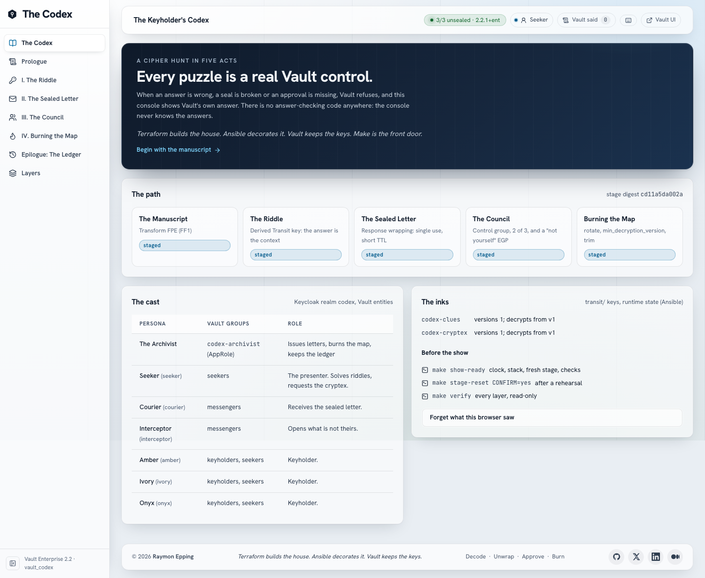
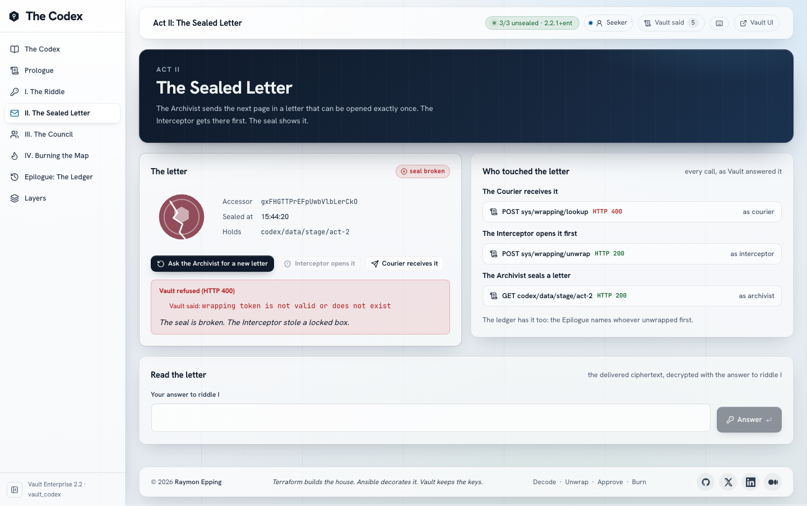
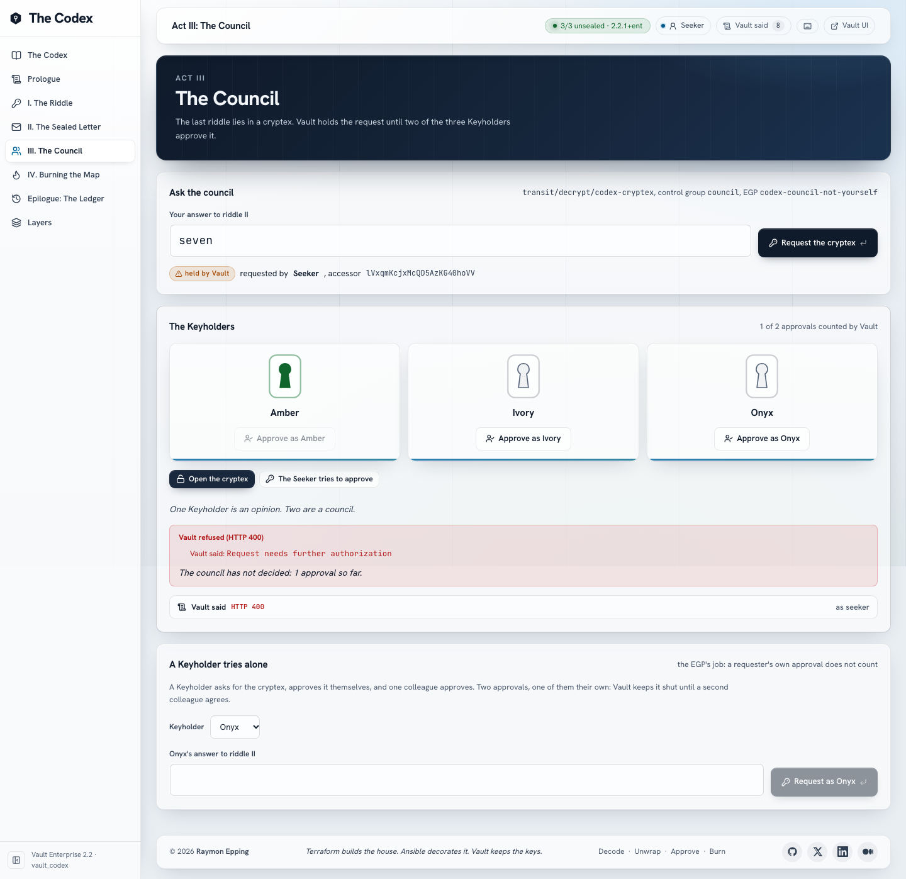
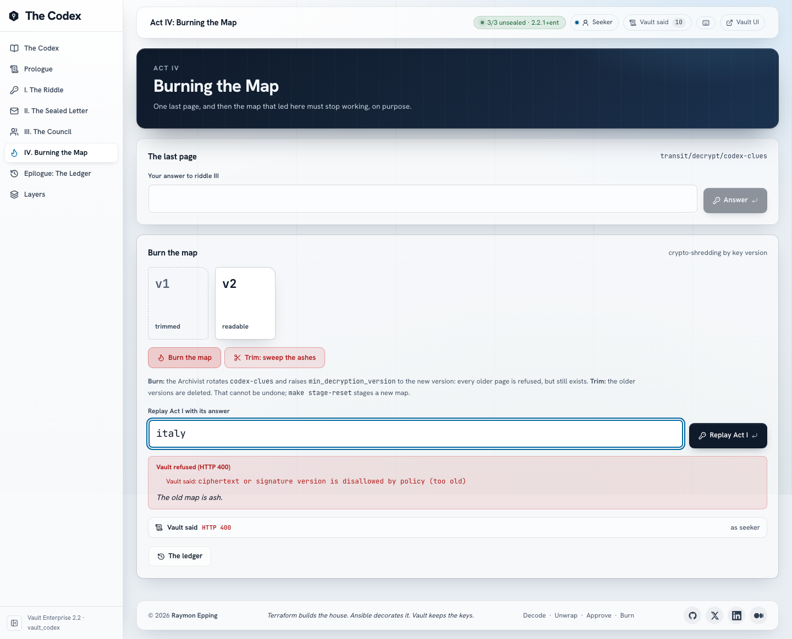
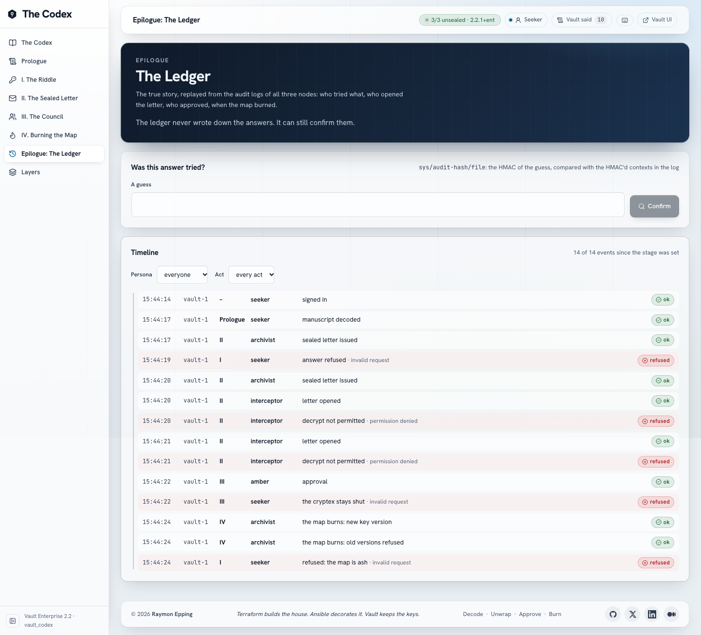
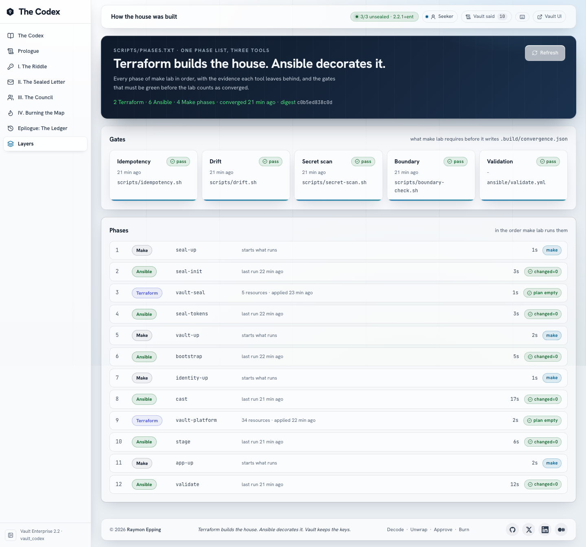
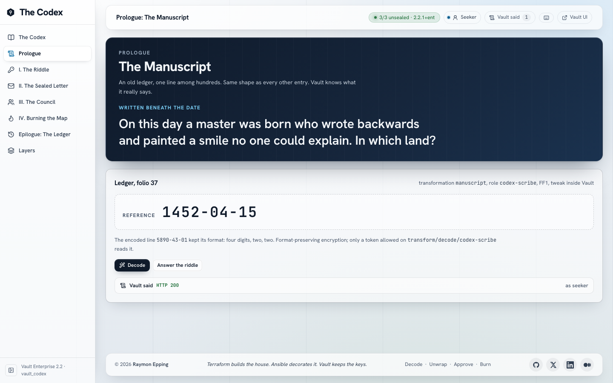

# The Keyholder's Codex

> **Terraform builds the house. Ansible decorates it. Vault keeps the keys.
> Make is the front door.**

A Vault Enterprise 2.2 lab that tells a cipher hunt in five acts, where every
puzzle is a real Vault control. A wrong answer, a broken seal, a missing
approval or a burned map is refused by Vault, and the console shows Vault's
own answer. There is no answer-checking code anywhere: the API and the
console never know the answers. A presenter plays every part from one
browser; Vault still sees six different people.



## What it shows

| Act | Story | Vault feature |
| --- | --- | --- |
| Prologue: The Manuscript | An innocent ledger line hides a date | Transform FPE (FF1, Advanced Data Protection) |
| I: The Riddle | Only the right answer opens the page | Transit key with `derived=true`; the answer is the context |
| II: The Sealed Letter | The Interceptor opens it first, and the seal shows it | Response wrapping: single use, short TTL |
| III: The Council | The final secret needs 2 of 3 Keyholders | Control group + a Sentinel EGP: your own approval does not count |
| IV: Burning the Map | Old clues become unreadable on purpose | `rotate`, `min_decryption_version`, `trim` |
| Epilogue: The Ledger | The true story, replayed | File audit devices on three nodes, `sys/audit-hash` |

**Proves:** context-bound decryption, single-use tamper evidence, M-of-N
approval enforced by Vault (including "not yourself"), crypto-shredding by key
version, a complete audit trail. **Illustrates only:** one-word answers are
not secrets; a dictionary cracks them in seconds. Act I says so on screen:
*"Context is not a password."*

The answers are in `config/codex.json` on purpose: they are story content,
not secrets, and the API image never receives that file. Spoilers in
[`docs/STORY.md`](docs/STORY.md).

## Requirements

- Apple Silicon Mac with a rootless Podman machine: 8 GiB of memory for
  Podman is enough (measured: about 1.2 GiB in use, container limits add up
  to 5 GiB), 10 GiB of free disk.
- A Vault Enterprise licence with **Transform Secrets Engine**, **Control
  Groups** and **Sentinel** (`make license-features` lists them).
- Terraform 1.14+, ansible-core 2.21+, the vault CLI, Node 24+, jq, openssl.

## First run

```bash
make env-init          # .env from .env.example; set VAULT_LICENSE in it
make license           # .secrets/vault/vault.hclic (never printed)
make gen-certs         # the lab CA and the listener certificate
make lab               # 12 phases, then idempotency, drift, secret scan, boundary
make trust-root        # optional: trust the lab CA in the macOS keychain
```

`make lab` runs from empty volumes in about three and a half minutes (images
already pulled) and from a converged lab in under two; a second run changes
nothing.

## Daily use

```bash
make up                # after a reboot or sleep: clock, vault-s, cluster, Keycloak, app
make show-ready        # five minutes before the talk: up, a fresh stage, verify, the console
make down              # stop everything; containers and volumes are kept
make doctor            # what is wrong and which command fixes it
```

The console is at <https://localhost:13701/>. Sign in as `seeker` (the
password: `make cast-copy-password U=seeker` puts it on the clipboard).

## The presenter's run sheet

| Act | Click | Vault answers | The wink |
| --- | --- | --- | --- |
| Prologue | Decode | the ledger line becomes a date | the digits settle |
| I | answer `france`, then the right land | `cipher: message authentication failed`, then the page | "Context is not a password." |
| II | Archivist seals, Interceptor opens, Courier receives | `wrapping token is not valid or does not exist` | "The Interceptor stole a locked box." |
| II | new letter, Courier receives, answer | the letter opens | |
| III | request; Seeker tries to approve; Amber; open | `permission denied`; `Request needs further authorization` | "One Keyholder is an opinion." |
| III | Ivory; open | the cryptex opens | |
| III | "A Keyholder tries alone": Onyx, Onyx approves, Amber, open | still shut: Vault does not count Onyx | "No Keyholder can vouch for their own request." |
| IV | answer; Burn; replay Act I; Trim | the final message; `too old`; version 1 gone | "The old map is ash." |
| Epilogue | the timeline; "Was this answer tried?" | who opened the letter, who approved; a guess confirmed by HMAC | "The ledger never wrote down the answers." |

Every action has a "Vault said" panel (the call, who made it, the node,
Vault's errors verbatim, the request id), and the topbar drawer lists all of
them. Left and right arrows move between acts; `?` lists the shortcuts.
After a rehearsal: `make stage-reset CONFIRM=yes`.

## Checks

| Command | What it proves |
| --- | --- |
| `make verify` | 90 read-only checks: Podman, every node, platform, stage, app, console, boundary, drift |
| `make rehearsal` | every act through the API, each way it must fail (42 cases) |
| `make api-test` | every API route on the live stack (35 cases) |
| `make test-ui` | the whole show in a browser at 1440x900 and 390x844, axe on every page |
| `make probe` | every mechanic proven on scratch mounts; writes `docs/capabilities.md` |
| `make boundary` | each scoped token can do its job and nothing else (27 checks) |
| `make idempotency`, `make drift`, `make secret-scan` | the gates of `make lab` |
| `make lint`, `make test-unit` | static checks and unit tests (also in CI) |

## Ports (127.0.0.1)

vault-s 19000, vault-1..3 19001-19003, API 13700, console 13701, Keycloak
13702. Override any of them in `.env`.

## What this lab does not do

- Production seal and recovery: vault-s is Shamir 1/1 and the cluster's
  recovery key is 1/1, both on disk in `.secrets/`.
- Remote Terraform state: state is local, in `.secrets/terraform/` (0600).
- Short-lived tool credentials: the four scoped tokens are periodic tokens on
  disk; a pipeline would use per-run identities.
- One person per persona: the API holds five personas' passwords so one
  presenter can play them (the stage-hand shortcut, `docs/security-model.md`).
- Real secrets as answers: one-word answers are contexts, not passwords.
- Persistent sessions: an API restart signs the presenter out.
- High availability for vault-s, or more than one Mac.

## More

- [`docs/architecture.md`](docs/architecture.md): topology, start order, the
  twelve phases and why the tools alternate.
- [`docs/ownership.md`](docs/ownership.md): who owns every resource.
- [`docs/security-model.md`](docs/security-model.md): every identity and its
  limits.
- [`docs/operations.md`](docs/operations.md): every make target, recovery.
- [`docs/capabilities.md`](docs/capabilities.md): what Vault 2.2.1 actually
  answered.
- [`DESIGN.md`](DESIGN.md): the console's design.
- Troubleshooting: `make doctor`.

| | |
| --- | --- |
|  |  |
|  |  |
|  |  |
